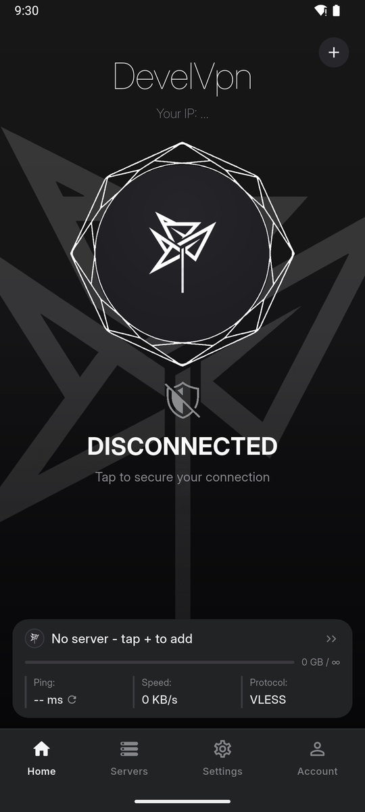
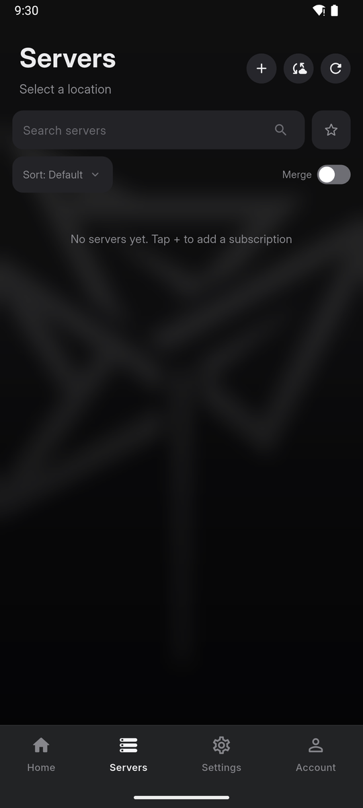
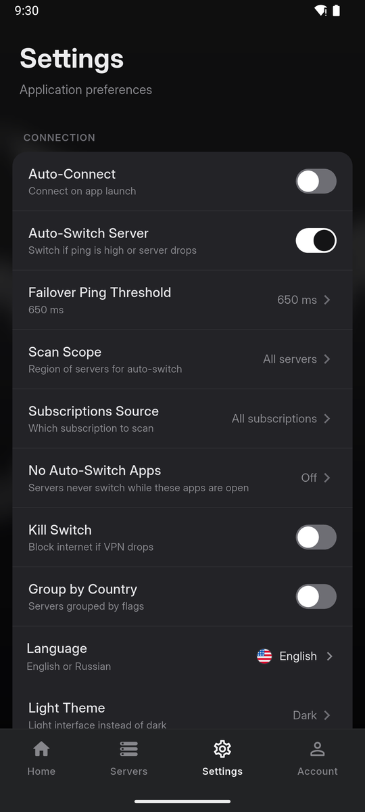
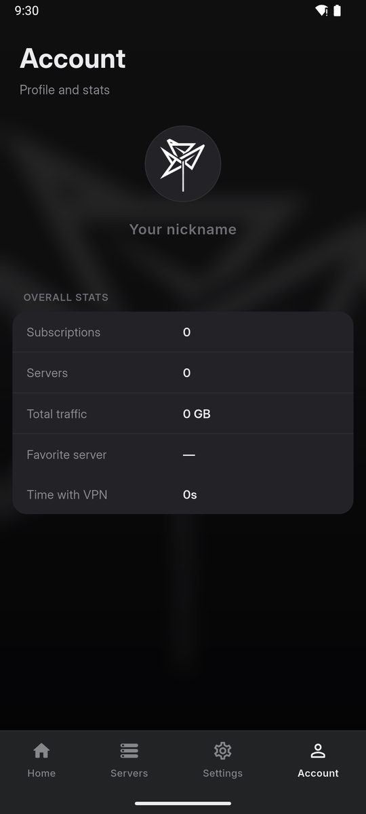

<div align="center">
  
</div>

# DevelVpn

[](LICENSE)
[](#)
[](#)
[](../../actions/workflows/build.yml)
[](../../releases/latest)

A lightweight, open-source VPN client for Android built with Flutter and the Xray core.
Imports VLESS/VMess/Trojan subscriptions (including base64 and Happ-style links),
connects through Reality / Vision / gRPC / TLS and keeps your traffic safe.

> **Disclaimer** — This project is provided for personal and educational use.
> You are responsible for complying with the laws of your country.

## Screenshots

<p align="center">
  
  
  
  
</p>

## Features

- **Subscriptions**: import via link, clipboard, QR code or manual vless entry;
  auto-refresh on a timer (3/12/24 h); per-subscription info (traffic, most used server, VPN time)
- **Smart server list**: search (incl. country names and IPs), sort, group by country
  with pinned countries, favorites, per-server ping history & speed test
- **Auto-switch**: pings servers in batches of 20, verifies candidates with a real
  delay check, remembers failed servers, per-app exemptions (e.g. don't switch during a game)
- **Tunnel settings** (Happ-style): TLS fragmentation, mux, preferred IP type,
  ad blocking, per-app proxy, LAN bypass, custom DNS, routing rules
- **Connection care**: kill switch (auto-restore after drops), auto-connect on launch,
  config export/import for phone-to-phone migration
- **UI**: dark & light themes (plus system-follow), home-screen widget,
  quick-settings tile, haptic feedback, full RU/EN localization
- **Ping service selector**: measure delay via Cloudflare, Google, Telegram,
  Instagram, YouTube or a custom URL
- **Live status**: server ping in the VPN notification, connection log with sharing

## Build

```bash
flutter pub get
flutter build apk --release
```

Requirements: Flutter 3.x, Android SDK 36, JDK 17.

The release build is signed with `android/app/develvpn-release.jks`
(credentials in `android/key.properties` — both files are git-ignored; provide your
own keystore if you fork the project).

## Project layout

```
lib/
  main.dart               app shell, tabs, theme resolution
  app_state.dart          central state: subs, servers, settings, usage stats
  services.dart           V2Ray controller, config builder, tunnel settings
  ping_manager.dart       TCP ping, ping cache & health history
  auto_switch.dart        auto-failover engine
  ota_service.dart        in-app updates from version.json
  theme.dart              dark/light palettes
  screens/                home, servers, settings, account
  widgets/                shared UI (gem button, shield, plate…)
  add_sheet.dart          subscription import flows (link/QR/manual)
android/                  native code: VPN widget, tile service, channels
```

## Tech notes

- Core: [Xray](https://github.com/XTLS/Xray-core) bundled via
  [flutter_v2ray_client](https://pub.dev/packages/flutter_v2ray_client)
- Server ping cache (5 min) + silent background refresh keep auto-switch fast
  without re-scanning everything
- Auto-switch exemptions read the foreground app through UsageStatsManager

## License

Released under the [MIT License](LICENSE).
